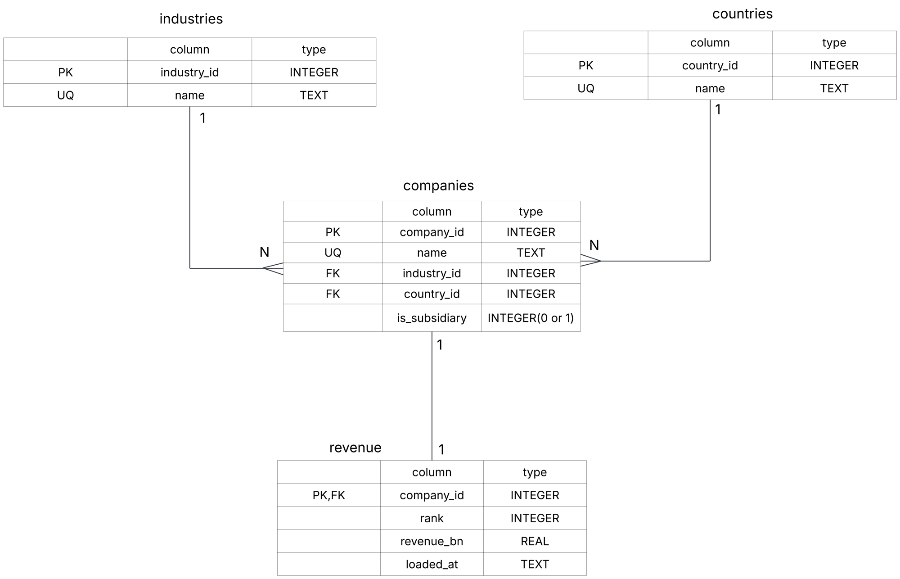

# Wikipedia Company Revenue Pipeline

A small ETL pipeline that scrapes the list of the largest African companies by
revenue from Wikipedia, cleans it, validates it, and loads it into SQLite.
Built with Python, SQLite and SQL only.

## Project structure

| File | Job |
|---|---|
| `extract.py` | Fetches the page and returns the matching table as raw text |
| `transform.py` | Cleans types, renames columns, merges duplicate industry labels, flags subsidiaries |
| `validate.py` | Checks the data before loading and the database after loading |
| `schema.sql` | Table definitions |
| `load.py` | Writes to SQLite; safe to run repeatedly |
| `main.py` | Runs extract -> transform -> validate -> load -> database checks |
| `test_validate.py`, `test_validate_db.py` | Feed the checks deliberately bad data to prove they catch it |

## How to run

```
pip install -r requirements.txt
python main.py
```

This creates `companies.db`. Run it as many times as you like: the result is the same.

## Database design



- `industries` and `countries` store each name once.
- `companies` links to both and flags subsidiaries (`is_subsidiary`).
- `revenue` has one row per company (`company_id` is both primary key and foreign key).

## Design decisions

- **Safe to re-run.** Names are `UNIQUE`, and loading uses upserts, so a second run updates rows instead of duplicating them.
- **Mirrors the latest scrape.** Companies that no longer appear on the page are deleted, along with industries and countries nothing uses any more. I decided that the database should always match the current source.
- **Validation runs before loading.** If the scrape comes back partial or broken, the pipeline stops before the delete step can remove good data.
- **Subsidiaries are flagged, not removed.** Some listed companies are subsidiaries of others on the list, so summing every row counts the same revenue twice. The `is_subsidiary` column lets queries include or exclude them.

## Validation

Before loading: row count, missing values, duplicate companies and ranks, revenue above zero, empty text, and a units check (revenue above 500 bn suggests the column changed from billions to millions).
After loading: every company has a revenue row, no broken foreign keys, row count matches, no leftover rows from earlier runs.
Out-of-order revenue is reported as a warning, because the source list itself has such rows (for example Ethiopian Airlines).

## Limitations

- The subsidiary list in `transform.py` was made by hand and may be incomplete.
- Column names are hardcoded. If Wikipedia renames them, the pipeline stops with a clear error.
- The `country` column assumes the page's Headquarters column holds countries.
- The test scripts download the live page, so they need an internet connection.