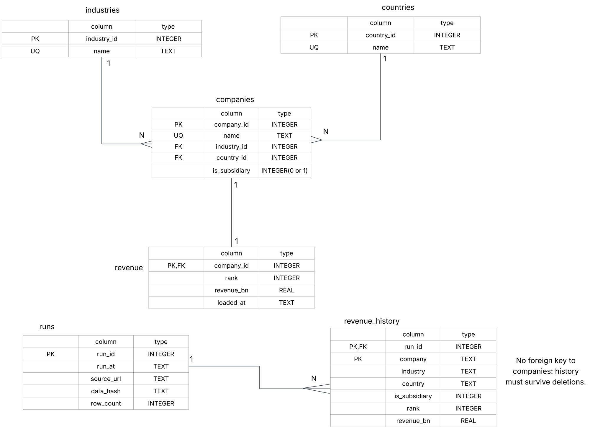

# Wikipedia Company Revenue Pipeline

A small ETL pipeline that scrapes the list of the largest African companies by
revenue from Wikipedia, cleans it, validates it, and loads it into SQLite.
Built with Python, SQLite and SQL only.

## Project structure

| File | Job |
|---|---|
| `config.json`, `config.py` | Settings: URL, dataset name, raw folder, database path |
| `extract.py` | Fetches the page and returns the matching table as raw text; logs any malformed rows it skips |
| `raw_store.py` | Saves each raw scrape to `data/raw/` and reads a saved file back |
| `transform.py` | Cleans types, renames columns, merges duplicate industry labels, flags subsidiaries |
| `validate.py` | Checks the data before loading and the database after loading |
| `schema.sql` | Table definitions |
| `load.py` | Writes to SQLite; safe to run repeatedly |
| `main.py` | Runs extract -> save raw -> transform -> validate -> load -> database checks |
| `tests/` | pytest tests that run offline on a saved sample (`tests/data/`) |
| `pytest.ini` | pytest settings |
| `history.py` | Records each changed run in `runs` and `revenue_history` |
| `demo_history.py` | Demo: two runs with changed data, queried with SQL |

## How to run

```
pip install -r requirements.txt
python main.py
```

This scrapes Wikipedia, saves the raw table to `data/raw/` with a timestamp, and creates `companies.db`. Run it as many times as you like: the result is the same.

To run from a saved raw file, with no internet:

```
python main.py --raw-file data/raw/africa_companies_<timestamp>.csv
```

To run the tests:

```
pytest
```

Settings such as the URL live in `config.json`. Progress and problems are reported with Python's `logging` module. Raw files in `data/raw/` are not committed to the repository.

## Database design



- `industries` and `countries` store each name once.
- `companies` links to both and flags subsidiaries (`is_subsidiary`).
- `revenue` has one row per company (`company_id` is both primary key and foreign key).

## History

The live tables (`companies`, `revenue`) always mirror the latest scrape. Past runs are kept separately:

- `runs`: one row per run that changed anything (time, source, a hash of the data, row count)
- `revenue_history`: one row per company per run, never updated

History stores company, industry and country as plain text, with no foreign key to `companies`. Companies that leave the source page are deleted from the live tables, but their history stays.

**Same data, no new snapshot.** Each run hashes the clean data and compares it with the latest run. If nothing changed, no snapshot is added, so re-running the pipeline never creates duplicate history.

Example, from `demo_history.py` (it builds a throwaway `demo.db`): which companies changed between two runs?

```sql
SELECT a.company, a.revenue_bn AS old_revenue, b.revenue_bn AS new_revenue
FROM revenue_history a
JOIN revenue_history b ON b.company = a.company
WHERE a.run_id = 1 AND b.run_id = 2 AND a.revenue_bn != b.revenue_bn;
```

```
Eskom: 13.941 -> 15.2
Sonatrach: 77.013 -> 80.0
```

## Design decisions

- **Safe to re-run.** Names are `UNIQUE`, and loading uses upserts, so a second run updates rows instead of duplicating them.
- **Mirrors the latest scrape.** Companies that no longer appear on the page are deleted, along with industries and countries nothing uses any more. I decided that the database should always match the current source.
- **Validation runs before loading.** If the scrape comes back partial or broken, the pipeline stops before the delete step can remove good data.
- **Subsidiaries are flagged, not removed.** Some listed companies are subsidiaries of others on the list, so summing every row counts the same revenue twice. The `is_subsidiary` column lets queries include or exclude them.
- **Raw data is kept.** Every live scrape is saved to `data/raw/` before any cleaning, so the pipeline can be re-run from a saved file and a bug in `transform` can be fixed without scraping again.
- **Skipped rows are never silent.** If a table row has the wrong number of cells, `extract` logs a warning showing the row. Completely empty rows are ignored.

## Validation

Before loading: row count, missing values, duplicate companies and ranks, revenue above zero, empty text, and a units check (revenue above 500 bn suggests the column changed from billions to millions).
After loading: every company has a revenue row, no broken foreign keys, row count matches, no leftover rows from earlier runs.
Out-of-order revenue is reported as a warning, because the source list itself has such rows (for example Ethiopian Airlines).

## Testing

The tests run with `pytest` and need no internet. They use a saved snapshot of the scraped table (`tests/data/africa_companies_sample.csv`) and a fake page for the extract step.

- `test_extract.py`: malformed rows are warned about, empty rows are ignored, the right table is picked by its columns
- `test_transform.py`: types, merged industry labels, subsidiary flags, a clear error for tied ranks like `=6`
- `test_validate.py`: each data check is fed deliberately bad data and must catch it
- `test_load.py`: loading twice creates no duplicates, removed companies are deleted, and the database checks catch broken data
- `test_history.py`: same data twice makes one snapshot, changed data makes a second one and keeps the old values, history survives deleted companies

## Limitations

- The subsidiary list in `transform.py` was made by hand and may be incomplete.
- Column names are hardcoded. If Wikipedia renames them, the pipeline stops with a clear error.
- The `country` column assumes the page's Headquarters column holds countries.
